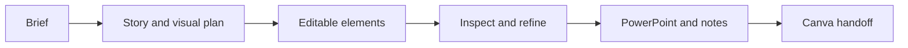
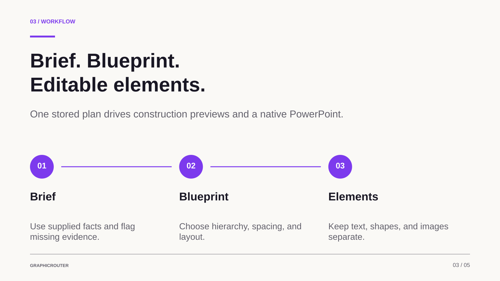

<p align="center">
  
</p>

<h1 align="center">GraphicRouter</h1>

<p align="center"><strong>Plan the story. Compose the elements. Direct the changes.</strong></p>

<p align="center">
  Turn a rough brief into editable infographics and presentations with a designer’s workflow inside ChatGPT.
</p>

<p align="center">
  <a href="https://github.com/4d696e6b/GraphicRouter/actions/workflows/check.yml"></a>
  
  
</p>

<p align="center">
  <a href="https://graphicrouter.vercel.app/">Website</a> ·
  <a href="https://graphicrouter.blue-hare-8389.chatgpt.site/product/">Sites mirror</a> ·
  <a href="https://chatgpt.com/plugins/plugin_asdk_app_sites_801c42220f4c8191bc43e3442008fd98">Open in ChatGPT</a> ·
  <a href="docs/CLIENT-SETUP.md">Customer setup</a> ·
  <a href="CONTRIBUTING.md">Contribute</a>
</p>

## What is GraphicRouter?

GraphicRouter helps ChatGPT work from a blank canvas: understand the brief, plan
the message, choose a composition, add individual elements, inspect the result,
and make focused revisions.

**Text belongs in text objects.** Headlines, labels, values and sources stay
separate from backgrounds and illustrations. The native renderer exports these
objects to PowerPoint for an editable Canva handoff. An imported design still
needs an actual Canva layer and visual check before delivery.



## What you can make

- **Infographics:** processes, comparisons, timelines and data stories on a native canvas.
- **Presentations:** a storyboard, individual slide compositions and speaker notes,
  with up to 40 pages in the flexible document workflow.
- **Longer stories:** chapter-based presentations, carousels and tall graphics,
  with saved source requirements and compact context reads.
- **Precise revisions:** change a named element while preserving prior versions
  and unrelated objects.
- **Existing Canva edits:** plan a focused change to an accessible design link,
  using the chat’s connected Canva tools for actual reads, drafts and approved saves.
- **Picture-aware briefs:** distinguish pictures to place, style references,
  edit instructions and material to extract. Upload and placement depend on the
  connected provider’s supported attachment workflow.

Eight specialist [design workflows](docs/DESIGN-SKILLS.md) cover structure,
storytelling, long presentations, tall formats, art direction, imagery, data and
brand adaptation. They share a quality-review workflow and load guidance on demand.

## See the output



*Prepared native engine output, not a live editor or a verified customer Canva result.*

[Download the sample presentation](website/assets/sample-presentation.pptx) ·
[Read its speaker notes](website/assets/sample-speaker-notes.txt) ·
[Browse the example slides](website/assets/)

## Try it in ChatGPT

1. Open [GraphicRouter’s ChatGPT page](https://chatgpt.com/plugins/plugin_asdk_app_sites_801c42220f4c8191bc43e3442008fd98)
   and sign in. Choose Install, Connect or Try in chat when offered.
2. Start a chat with GraphicRouter selected. Supply your topic, audience, goal,
   facts and any reference pictures or Canva link.
3. Complete the short adaptive brief, review the composition, and direct changes.
4. Connect your own Canva account when you want Canva actions.

Customers do **not** need an environment file, developer credentials or an OpenAI
API key. The website opens the ChatGPT page; it does not install the plugin automatically.

**Availability:** the website is public by link. The ChatGPT app is still in
Development mode; installation by a separate eligible customer account remains
unverified. ChatGPT account and workspace policies determine availability.
See [customer setup](docs/CLIENT-SETUP.md).

## Run locally

Use **Node.js 24** from [.nvmrc](.nvmrc), then:

```sh
git clone https://github.com/4d696e6b/GraphicRouter.git
cd GraphicRouter
npm ci
npm run check
npm run dev
```

Open [http://127.0.0.1:5173](http://127.0.0.1:5173). The product site is at
`/product/`, setup help at `/install`, and the standalone brief at `/briefing`.
Local UI preview is not an authenticated production ChatGPT connection.

Canva OAuth and stored design operations need additional local configuration.
Follow [developer setup](src/server/SETUP.md) for D1/R2, migrations, credentials
and production-style local checks. No additional model service is used: ChatGPT
supplies the structured content and design choices.

Useful commands:

```sh
npm run check                                  # TypeScript and tests
npm run build                                  # Production Worker; does not publish
node scripts/generate-static-website.mjs --check # Website HTML and asset consistency
```

## How the repository fits together

```text
app/                 Web pages, authenticated routes and MCP endpoint
src/briefing/        Adaptive questions and host workflow guidance
src/design-skills/   Canonical design guidance and examples
src/contracts/       Shared schemas and engine/service interfaces
src/engine/          Geometry, validation, revisions, SVG/PNG and native PPTX
src/mcp/             Tool registration and ChatGPT instructions
src/server/          Authorization, versioned storage and export services
src/integrations/    Canva OAuth and import adapter
src/preview/         Embedded ChatGPT view and preview components
src/fixtures/        Labelled example inputs and Canva import probe
website/             Standalone product website source
skills/              Generated portable design guidance
drizzle/             Database migrations
tests/               Engine, contract, UI and integration checks
```

See [architecture](docs/ARCHITECTURE.md) for the data flow and the difference
between native composition, Canva import and same-file Canva editing.

## Development and branches

`main` is the integrated baseline. The two builder branches remain available:
`feat/slide-engine` for Builder A and `feat/chatgpt-canva` for Builder B. Start from
current `main`, keep each builder in a separate clone, and use pull requests for
review. A GitHub push does not publish the hosted Site.

Read [contributing](CONTRIBUTING.md), [coordination](docs/COORDINATION.md) and the
[shared contracts](docs/CONTRACTS.md) before implementation. The original
hackathon work log is retained in the [Builder A](docs/tasks/builder-a-slide-engine.md)
and [Builder B](docs/tasks/builder-b-chatgpt-canva.md) task files.

## Current limits and verification

The native toolkit uses measured English Arial text, rectangles, ellipses,
straight lines and registered PNG/JPEG assets. Arbitrary fonts, languages,
illustrations and uploads are not automatically supported by the native engine.
Canva-connected routes have separate provider capabilities and account requirements.

Blueprint revisions are immutable. Each native Canva import creates a new design;
manual Canva edits do not synchronize back to the GraphicRouter blueprint.
Snapshot review helpers advise on supplied data; they do not independently fetch
Canva, run OCR, verify facts or guarantee visual quality.

The latest recorded checks on 2026-10-16 passed TypeScript, 288 tests across 46 files
and the production build. Provider editability/fidelity, attachment placement,
cross-account installation and a complete live rehearsal remain separate checks.
Outstanding upstream dependency advisories are recorded in
[release quality](docs/RELEASE-QUALITY.md); this prototype is not presented as a
completed marketplace or security-reviewed release.

## Documentation and notices

- [Customer connection guide](docs/CLIENT-SETUP.md)
- [Developer setup](src/server/SETUP.md)
- [Architecture](docs/ARCHITECTURE.md)
- [Design skills and long-context limits](docs/DESIGN-SKILLS.md)
- [Existing Canva designs and pictures](docs/CANVA-EDITING.md)
- [Website authoring](website/README.md)
- [Vercel website deployment](docs/VERCEL.md)
- [Release evidence and remaining gates](docs/RELEASE-QUALITY.md)

No project-wide license has been declared yet. Preserve the bundled third-party
notices, including the [website reference notice](website/notices/RepoSetup-LICENSE.txt),
[font licenses](website/fonts/README.md), [inspection-font license](src/engine/raster-assets/LICENSE)
and [Sites build notice](build/sites-vite-plugin.LICENSE).
