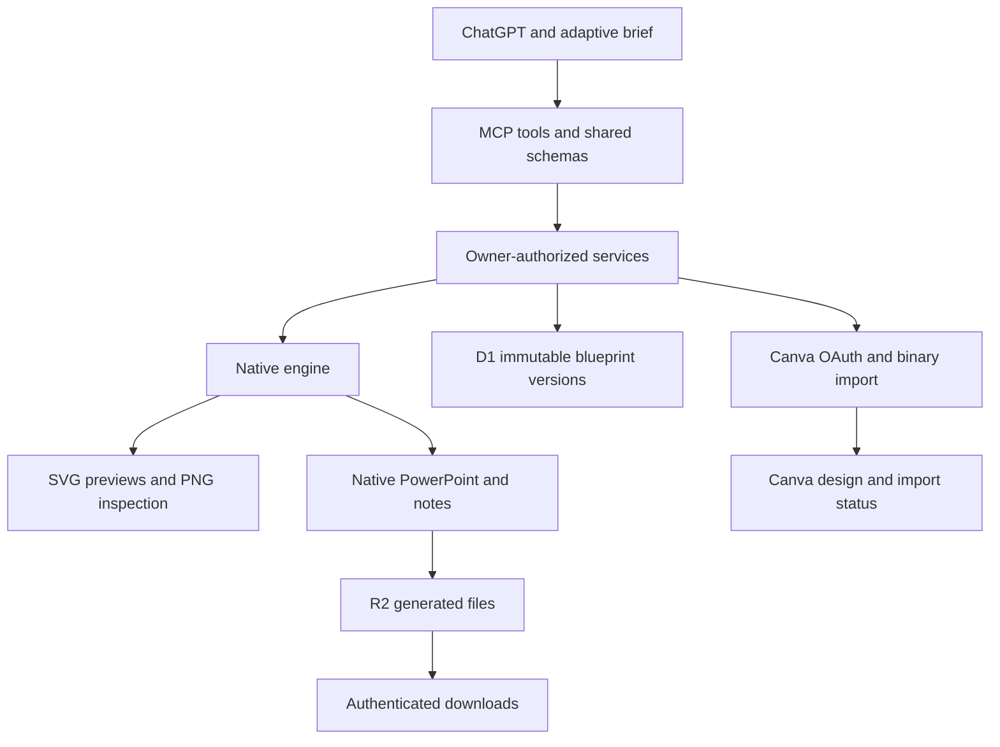

# Architecture

GraphicRouter has one TypeScript application and a standalone product website.
ChatGPT supplies the story, composition decisions and structured tool arguments.
There is no additional model API in the native pipeline.

## Native composition and handoff

- `src/contracts/` is the executable interface: schemas, operations and engine ports.
- `src/engine/` validates and renders structured elements. Native export and
  previews share the stored blueprint. It owns no HTTP, identity or persistence.
- `src/server/` enforces ownership, immutable version writes, stale-write rejection,
  generated files and import job state. `db/` and `drizzle/` define persistence.
- `src/mcp/` exposes tools and host guidance. `src/preview/` serves the shared
  embedded and authenticated preview experience.
- `src/design-skills/library.json` supplies bounded on-demand design guidance;
  generated `skills/` files are portable copies, not a second source of truth.

The legacy deck workflow has exactly five slides and two note durations. Canvas
objects support freeform placement within validated primitives and bounds.
Flexible documents support 1–40 pages and use the same native object vocabulary.
See [contracts](CONTRACTS.md) and [design limits](DESIGN-SKILLS.md).

## Long briefs and revisions

A long document can retain ordered source chunks and registered requirements.
The host reads a compact checkpoint or a small page/chapter window, applies a
bounded revision, and reviews requirement coverage before export. This reduces
repeated full-document reads; it does not guarantee model recall or completeness
of a requirement the host never registered.

Edits require a current base version and stable targets. Failed edits preserve
the previous version. Imported manual Canva edits do not update the blueprint.
Each new native-version import creates a separate Canva design.

## Two separate Canva connections

**Application OAuth/import:** the backend uses owner-configured developer
credentials, per-user OAuth, encrypted stored tokens and asynchronous import jobs.
It uploads native PowerPoint bytes and retains the returned job/design identity.
Polling does not start replacement imports. Ambiguous outcomes require inspection
rather than an automatic side-effect retry.

**ChatGPT’s connected Canva tools:** the host can read an accessible existing
Canva link, prepare a transaction, inspect the latest draft and save with the
provider’s required approval. New Canva generation and template adaptation also
use this connection. An application OAuth connection does not imply these tools
are available, or vice versa.

`plan_canva_edit`, `review_canva_edit`, `review_canva_design` and `plan_image_input`
plan or check caller-supplied information. They do not themselves fetch designs,
perform OCR, upload attachments, commit edits or certify provider state. Review
real layers and the final preview in Canva. See [Canva editing](CANVA-EDITING.md).

## Website, identity and deployment

The standalone `website/` source is copied through an explicit allowlist to
`public/product/` during dev/build. `/` redirects to `/product/`; `/install`
provides customer help. These pages open the exact ChatGPT plugin link rather
than installing it or running design tools for visitors.

Sites supplies authenticated identity for tool and private data routes. The
server checks ownership; caller-provided identity is not a supported substitute.
Local identity simulation proves no production account connection. Public website
visibility grants no access to another customer’s designs or tokens.

`.openai/hosting.json` identifies the selected Site. GitHub and hosted source
repositories have distinct publication flows. A local production build or GitHub
merge alone does not deploy the Site. Preserve both Original/Test identities,
the current audience and all server-side secrets.

## Evidence

Tests cover native revisions/export, local routes, owner isolation, requirement
storage, UI handoff and mocked provider failures. Live account, imported font/layer
fidelity, actual attachment placement, and an end-to-end pitch rehearsal require
separate evidence. Current records are in [release quality](RELEASE-QUALITY.md)
and the dated [Builder A checklist](tasks/builder-a-slide-engine.md).
